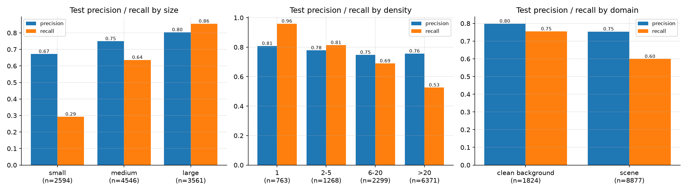
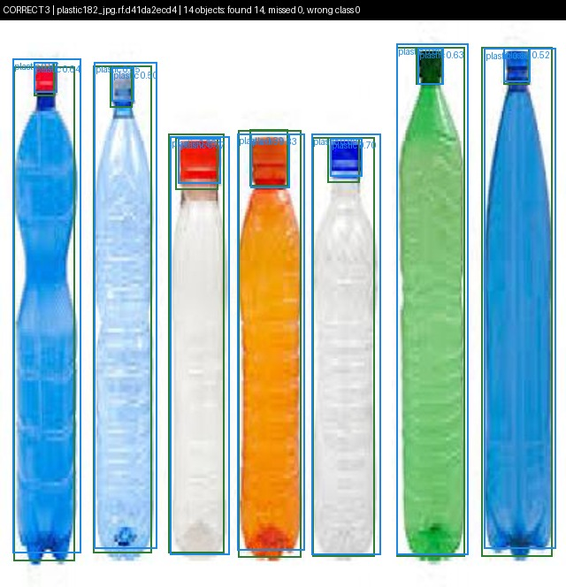
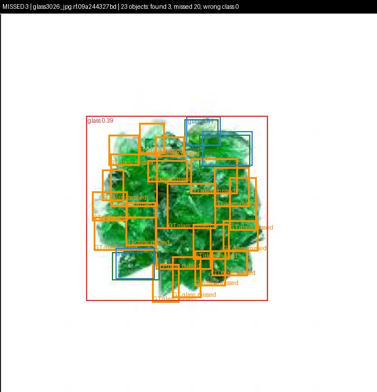
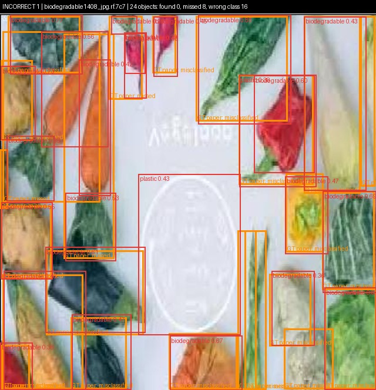

# Object Detection for Automated Waste Sorting

A YOLO26s detector that finds and classifies waste in images (biodegradable, cardboard, glass, metal, paper, plastic), built from a dataset analysis, evaluated on a held-out test set, and examined through a detailed error analysis. A second part proposes a deep metric learning concept for retrieving similar waste objects and handling unknown items.

Computer Vision portfolio project, THWS (Technische Hochschule Würzburg-Schweinfurt), winter semester 2026/27.

## Results

| Split | mAP50-95 | mAP50 | Precision | Recall |
| --- | --- | --- | --- | --- |
| Validation | 0.500 | 0.713 | 0.805 | 0.619 |
| **Test** | **0.523** | **0.732** | 0.798 | 0.633 |

| Class | Test AP50 | Test AP50-95 | Recall |
| --- | --- | --- | --- |
| glass | 0.885 | 0.668 | 0.811 |
| metal | 0.839 | 0.623 | 0.764 |
| paper | 0.682 | 0.534 | 0.598 |
| cardboard | 0.668 | 0.519 | 0.560 |
| plastic | 0.626 | 0.399 | 0.508 |
| biodegradable | 0.692 | 0.398 | 0.559 |

Key findings:

- **Object size and crowding decide what is found:** 86 % of large objects are detected but only 29 % of small ones; 96 % of objects in single-object images but 53 % in piles of more than 20.
- **The main error is missing objects, not confusing classes:** 31 % of test objects are missed, 1.5 % get the wrong class.
- **Some errors are label errors:** e.g. vegetables annotated as "paper"; 133 images have labels that contradict their file-name class.
- Inference: about 5 ms per image on an RTX 5060 Laptop GPU.



## Pipeline

| Step | Module | What it does |
| --- | --- | --- |
| Dataset analysis | `waste/analysis.py` | Class balance, objects per image, object sizes, image domain, label quality, near-duplicates |
| Split | `waste/split.py` | 70 / 15 / 15, stratified by class and crowding, near-duplicates kept together, fixed seed |
| Model selection | `waste/training.py` | 15-epoch pilots of YOLO11s and YOLO26s compared on validation (0.403 vs 0.436 mAP50-95) |
| Training | `waste/training.py` | YOLO26s, COCO-pretrained, 640 px, 60 epochs, augmentation chosen from the data analysis |
| Evaluation | `waste/evaluation.py` | Test mAP, per-class AP, confusion matrix, threshold chosen on validation, breakdowns |
| Error analysis | `waste/errors.py` | Every object classified as correct / missed / wrong class / imprecise; example images |
| Demo | `waste/demo.py` | Run the trained model on any image |

Data-driven design decisions:

| Finding | Decision |
| --- | --- |
| 61 % of boxes are biodegradable | Stratified split, per-class AP |
| Up to 358 objects per image | `max_det = 500` (YOLO default: 300) |
| 26 % of objects smaller than 32 px | Train at 640 px instead of the native 416 px |
| Objects cluster in the image centre | Translate, scale and mosaic augmentation |
| 33 % product photos on white backgrounds | Colour augmentation, results reported per domain |
| 17 images with zero-size boxes | Excluded |

## Repository structure

```
main.py                 command-line entry point: python main.py <stage>
waste/
  config.py             all settings in one place
  data.py               loading images and labels, box geometry, duplicates
  plots.py              chart helper
  analysis.py           Task 1: dataset analysis
  split.py              Task 1: train / val / test split
  training.py           Task 2: model selection and training
  evaluation.py         Task 2: test-set evaluation
  errors.py             Task 3: error analysis
  demo.py               prediction on any image
analysis/               dataset statistics and figures
splits/                 image lists of the split + dataset YAML
results/                training runs, test metrics, error analysis
```

## Setup

Python 3.12 and an NVIDIA GPU are recommended.

```bash
python -m venv .venv
.venv\Scripts\activate          # Windows; on Linux/macOS: source .venv/bin/activate
pip install torch==2.11.0 torchvision==0.26.0 --index-url https://download.pytorch.org/whl/cu128
pip install -r requirements.txt
```

The dataset is not part of this repository. Place the Garbage Detection Dataset (YOLO format, Roboflow export) so that the images are in `GarbageDataset/GarbageDataset/images/` and the labels in `GarbageDataset/GarbageDataset/labels/`.

## Usage

```bash
python main.py analyze                                  # dataset analysis        -> analysis/
python main.py split                                    # train / val / test split -> splits/
python main.py train --model yolo11s.pt --epochs 15     # pilot run
python main.py train --model yolo26s.pt --epochs 15     # pilot run
python main.py compare                                  # pilots compared on validation
python main.py train                                    # final training (YOLO26s, 60 epochs)
python main.py evaluate                                 # test-set metrics        -> results/test_eval/
python main.py errors                                   # error analysis          -> results/error_analysis/
python main.py predict --image path/to/photo.jpg        # boxes on any image      -> results/demo/
```

The trained model is `results/train/yolo26s_640_60ep/weights/best.pt`.

## Example detections

| Correct | Missed | Incorrect |
| --- | --- | --- |
|  |  |  |

Green: ground truth found · orange: ground truth missed · blue: correct prediction · red: wrong class or false alarm · purple: imprecise box or duplicate.

## Team

Priyam Jha, Dhrumil, Abin. Individual contributions are listed in the contribution statement submitted with the portfolio.

## Acknowledgements

- [Ultralytics](https://github.com/ultralytics/ultralytics) for YOLO26 and YOLO11
- The Garbage Detection Dataset (Roboflow export) provided for the course
